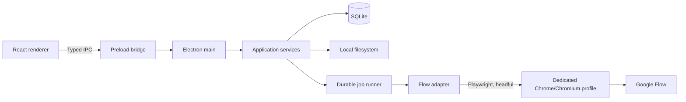

# Kiến trúc và công nghệ

## 1. Mục tiêu kiến trúc

- Local-first, hoạt động được với dữ liệu Episode/Scene/media khi không có mạng; chỉ phần Flow cần Internet.
- Một desktop app, một database, không backend riêng và không microservice.
- Tách UI, quyền truy cập hệ thống và automation đủ rõ để giảm rủi ro bảo mật.
- Queue có thể phục hồi sau crash/restart và không tạo generation trùng ngoài ý muốn.
- Adapter Flow cô lập selector và logic UI để thay đổi Flow không lan sang phần còn lại.
- Ưu tiên code dễ hiểu, có đường nâng cấp nhưng không thiết kế cho nhu cầu chưa tồn tại.

## 2. Kiến trúc đề xuất



### Renderer

- React + TypeScript cho Episode list/workspace, template editor, Scenes editor, Assets, queue, review và media library.
- Không truy cập trực tiếp Node.js, filesystem, SQLite hoặc Playwright.
- Không giữ trạng thái queue làm nguồn dữ liệu chính; renderer đọc snapshot và nhận event từ main process.

### Preload bridge

- Bật `contextIsolation`; tắt `nodeIntegration` trong renderer.
- Chỉ expose các lệnh theo use case, ví dụ `episode.create`, `scene.update`, `queue.pause`, không expose IPC hoặc filesystem tổng quát.
- Validate cả request và response bằng schema dùng chung.

### Electron main / application services

- Sở hữu database, migration, filesystem, dialog chọn folder và lifecycle của browser automation.
- Chứa use case nghiệp vụ: Episode, Template, Scene, Asset, Queue, Review, Media, Export.
- Chạy job runner bất đồng bộ trong main ở bản đầu. Chỉ tách worker process nếu PoC chứng minh Playwright làm main process mất ổn định.

### Flow adapter

- Là lớp duy nhất biết URL, locator và state UI của Google Flow.
- API nội bộ theo hành vi: `ensureSignedIn`, `createProject`, `openProject`, `submitGeneration`, `observeAttempt`, `renameAsset`, `downloadAsset`.
- Locator ưu tiên role/label/accessibility name; selector dựa vào class sinh tự động chỉ là phương án cuối.
- Mỗi action có precondition, postcondition, timeout, screenshot lỗi có kiểm soát và lỗi có mã.
- Không gọi endpoint private, không chặn/sửa request Flow và không tìm cách bypass cơ chế chống automation.

## 3. Local storage

### 3.1. Phân vùng dữ liệu

| Vị trí logic | Nội dung | Backup |
| --- | --- | --- |
| Electron `userData` | `app.db`, settings, migration state, log đã lọc | Có |
| Profile automation riêng | Cookie/session/cache của Chrome/Chromium | Không đưa vào backup thông thường |
| Workspace do người dùng chọn | Media gốc, thumbnail local, export, manifest, Scenes/narration export | Có |
| Temp/staging | Download chưa xác minh và artifact tạm | Có thể dọn an toàn khi không còn job |

Đề xuất mặc định trên Windows:

- Metadata: vị trí trả về bởi `app.getPath('userData')`.
- Browser profile: một thư mục riêng dưới dữ liệu local của app, không dùng Chrome profile mặc định.
- Media workspace: người dùng chọn khi khởi tạo app; app lưu đường dẫn tương đối khi file nằm dưới workspace.

Không lưu Google password. Cookie/session chỉ tồn tại trong profile browser riêng. Nếu sau này thêm API key cho LLM, dùng Windows Credential Manager/OS credential store; không ghi plaintext vào SQLite hoặc log.

### 3.2. SQLite và filesystem

SQLite giữ metadata, quan hệ, queue và audit. Binary media nằm trên filesystem; database chỉ lưu path, size, MIME, hash và trạng thái.

Thiết lập đề xuất:

- Foreign key bật.
- WAL mode để đọc UI trong khi queue ghi trạng thái.
- Migration tuần tự, có backup database trước migration quan trọng.
- Transaction cho thay đổi nhiều bảng, đặc biệt khi accept media hoặc hoàn tất download.
- Path chuẩn hóa theo Windows nhưng manifest export dùng dấu `/` tương đối để dễ di chuyển.
- Hash SHA-256 cho media đã download và export.

## 4. Data model

Tên trường dưới đây là logical schema; kiểu và migration cụ thể chỉ được chốt khi implement.

### `episodes`

| Trường | Ý nghĩa |
| --- | --- |
| `id` | UUID local ổn định |
| `title`, `topic`, `slug` | Thông tin Episode |
| `status` | Trạng thái nghiệp vụ |
| `flow_project_id` | ID nếu quan sát được ổn định; nullable |
| `flow_project_url` | URL project để mở lại |
| `flow_project_name` | Tên đã xác minh trên Flow |
| `settings_json` | Aspect ratio/model/output mặc định đã validate |
| `created_at`, `updated_at` | UTC timestamp |

### `prompt_templates` và `prompt_template_versions`

- `prompt_templates`: identity, name, purpose, current version.
- `prompt_template_versions`: immutable content, biến cho phép, schema/version, thời điểm tạo.
- Scene được import có thể lưu `source_template_version_id` để biết Scene Template nào đã tạo payload. Phase 1 không lưu một Script object hoặc rendered-script snapshot riêng.

### Scene creation flow — không có `scripts`

- `Script` không phải domain object, module UI, repository hay bảng SQLite trong Phase 1.
- Flow tạo Scenes nhận metadata Episode, Scene Template version và `Nội dung nguồn` tùy chọn để render prompt cho người dùng copy sang ChatGPT.
- `Nội dung nguồn`, rendered prompt và raw JSON đang preview là state tạm của flow; không có revision/persistence riêng. Sau khi import thành công, danh sách Scene có cấu trúc là nguồn dữ liệu chính.
- Import JSON dùng validation trước transaction; payload sai không tạo Scene nửa chừng.

### `scenes`

| Trường | Ý nghĩa |
| --- | --- |
| `id`, `episode_id` | Identity và owner |
| `scene_order` | Thứ tự hiện hành, unique trong Episode |
| `title`, `summary`, `narration` | Nội dung biên tập |
| `image_prompt`, `video_prompt` | Prompt làm việc hiện hành |
| `status` | Draft/review/approved/needs changes |
| `revision_no` | Optimistic concurrency đơn giản |
| `source_template_version_id` | Scene Template đã dùng khi import; nullable với Scene tạo thủ công |
| `created_at`, `updated_at` | UTC timestamp |

Phase 1 không có `scene_revisions`. Scene được cập nhật trực tiếp; khi một prompt được dùng để generate media ở Phase 2, `generation_attempts.prompt_snapshot` giữ bằng chứng bất biến của lần tạo đó.

### `character_references`

- Metadata cho file reference local: tên, path, MIME, hash, thumbnail.
- Có thể gắn mặc định cho Episode hoặc gắn riêng cho asset slot.
- Join table giữ thứ tự reference vì UI/model có thể giới hạn số lượng và vai trò.

### `asset_slots`

Đây là đơn vị đầu ra logic, ví dụ `scene-01-02`, tách khỏi lần thử tạo.

| Trường | Ý nghĩa |
| --- | --- |
| `id`, `scene_id` | Identity và scene |
| `asset_order` | Số thứ tự trong scene |
| `canonical_name` | Tên cần có trên Flow và local |
| `media_type` | `image` hoặc `video` |
| `required` | Có bắt buộc để hoàn tất Episode không |
| `accepted_media_version_id` | Candidate được duyệt, nullable |

Unique constraint đề xuất: `(scene_id, asset_order)` và `canonical_name` trong một Episode.

### `generation_attempts`

- Mỗi lần bấm generate là một record mới, không update đè attempt cũ.
- Lưu `attempt_no`, `prompt_snapshot`, `settings_snapshot`, reference snapshot/hash, thời điểm submit và trạng thái.
- `submission_token` là ID local để chống double-click; không giả định Flow nhận token này.
- `remote_evidence_json` chỉ lưu bằng chứng quan sát được an toàn như project URL, số output, thời gian, prompt text đã đối chiếu; không lưu cookie/token.

### `flow_assets`

- Liên kết output quan sát được với `generation_attempt`.
- Lưu remote asset ID nếu Flow công khai nó trong URL/DOM; nếu không có, lưu fingerprint có mức tin cậy và bằng chứng đối chiếu.
- Các trường chính: `flow_project_ref`, `remote_asset_ref`, `observed_name`, `expected_name`, `observed_prompt`, `observed_created_at`, `mapping_confidence`, `rename_verified_at`.
- Nếu `mapping_confidence` không đạt ngưỡng chắc chắn, automation phải dừng chờ người dùng.

### `media_versions`

- Một record cho mỗi file/candidate local.
- Lưu source Flow asset, path, extension, size, SHA-256, dimensions/duration nếu đọc được, `accepted_at`, `rejected_at`.
- File accepted không bị ghi đè khi có generation mới.

### `jobs` và `job_events`

`jobs` là queue bền vững; `job_events` là nhật ký append-only phục vụ chẩn đoán.

Trường quan trọng của `jobs`:

- `kind`, `status`, `priority`, `episode_id`, `asset_slot_id`, `attempt_id`.
- `payload_json` đã validate và `checkpoint_json` tối thiểu.
- `retry_count`, `max_retries`, `next_run_at`.
- `lease_owner`, `lease_expires_at` để phục hồi job bị bỏ dở.
- `last_error_code`, `last_error_message` đã lọc dữ liệu nhạy cảm.
- `created_at`, `started_at`, `finished_at`.

### `exports`

- Snapshot export gồm Episode revision, danh sách media hash, destination và manifest hash.
- Một export mới không sửa export cũ.

## 5. Queue và tính idempotent

Job chain tối thiểu cho một asset:

```text
ENSURE_PROJECT
  -> SUBMIT_GENERATION
  -> OBSERVE_GENERATION
  -> WAIT_FOR_REVIEW
  -> RENAME_FLOW_ASSET
  -> VERIFY_FLOW_NAME
  -> DOWNLOAD_ASSET
  -> VERIFY_DOWNLOAD
```

Quy tắc:

- Một worker logic và concurrency generation mặc định bằng 1 trong Phase 2.
- Job được claim bằng transaction; lease hết hạn cho phép reconcile sau crash.
- Chỉ các action xác định là an toàn mới retry tự động.
- `SUBMIT_GENERATION` có trạng thái `unknown` nếu không biết click đã được Flow nhận hay chưa. Không click lại cho đến khi reconcile.
- `RENAME_FLOW_ASSET` luôn đọc tên trước và sau thao tác. Nếu tên đã đúng thì coi là thành công idempotent.
- `DOWNLOAD_ASSET` lưu vào `.part`, xác minh rồi atomic rename sang tên cuối.
- `Pause` là flag ở queue; không giết browser và không phá transaction đang chạy.

## 6. Dependencies đề xuất

Không khóa số version trong tài liệu kế hoạch. Khi bắt đầu implement, chọn một bộ version tương thích và commit lockfile.

### Runtime chính

| Package/công nghệ | Vai trò | Ghi chú |
| --- | --- | --- |
| Electron | Desktop shell, main/preload/renderer | Giữ security defaults chặt |
| React + TypeScript | UI và type safety | Không cần framework web SSR |
| Vite / electron-vite | Dev/build pipeline | Giảm cấu hình nhiều entry Electron |
| Playwright | Điều khiển Chrome/Chromium headful | Dùng persistent context dành riêng |
| SQLite + `better-sqlite3` | Metadata và durable queue | Native module; phải kiểm tra rebuild/packaging sớm |
| Zod | Validate IPC, import, settings và job payload | Schema dùng chung giữa process |
| Zustand hoặc React context | UI state ngắn hạn | Chỉ chọn một; ưu tiên Zustand nếu state editor phức tạp |
| `electron-log` | Log local có rotation/redaction | Không log secret/cookie |

### Development và chất lượng

- Vitest cho domain/service tests.
- React Testing Library cho editor và workflow UI.
- Playwright Test chỉ cho smoke/E2E của chính app và Flow PoC có kiểm soát.
- ESLint + Prettier.
- Electron Builder hoặc Electron Forge để đóng gói; chọn một sau spike native module, không dùng đồng thời.

### Cố ý chưa thêm

- Redux, RxJS, message broker, server database, Docker, Kubernetes.
- ORM nặng. SQL migration nhỏ và repository rõ ràng là đủ; có thể cân nhắc Drizzle nếu số query tăng đáng kể.
- FFmpeg trong Phase 1/2. Phase 3 chỉ thêm nếu cần đọc duration/thumbnail mà API hệ điều hành không đủ.
- SDK LLM trong Phase 1; bản tối thiểu render/copy Scene Template và paste/import JSON Scenes thủ công.

## 7. Bảo mật

- `contextIsolation: true`, `nodeIntegration: false`, sandbox renderer nếu tương thích.
- Content Security Policy không cho thực thi script tùy ý.
- Allowlist IPC channel và validate mọi path/input ở main.
- Mọi thao tác file phải bị giới hạn trong workspace hoặc destination do người dùng chọn.
- Chặn path traversal từ tên Episode/scene; canonical name chỉ dùng ký tự an toàn.
- Browser profile không nằm trong export/backup và có nút mở vị trí/xóa session có cảnh báo ở Phase sau.
- Screenshot/trace có thể chứa nội dung project; mặc định chỉ chụp khi lỗi và có chính sách retention.
- Không đọc hay điều khiển Chrome profile cá nhân.

## 8. Observability và lỗi

- Mỗi automation run có `correlation_id` xuyên suốt job/event/log.
- UI hiển thị lỗi theo hành động: `AUTH_REQUIRED`, `FLOW_UI_CHANGED`, `RATE_LIMITED`, `CREDIT_REQUIRED`, `POLICY_BLOCKED`, `MAPPING_AMBIGUOUS`, `RENAME_UNVERIFIED`, `DOWNLOAD_INVALID`.
- Lỗi cho người dùng gồm bước thất bại, tác động, hành động có thể làm và nút resume/reconcile.
- Diagnostic bundle chỉ chứa log đã redaction, schema/app version và screenshot người dùng chọn; không chứa browser profile.

## 9. Khả năng thay thế Flow bằng API

Gemini API có API chính thức để tạo video bằng Veo và trả về long-running operation, phù hợp hơn UI automation về độ ổn định. Tuy nhiên API đó không tạo/đổi tên asset trong project Google Flow nên không đáp ứng nguyên vẹn yêu cầu Phase 2. Kiến trúc giữ `GenerationProvider`/adapter boundary ở mức vừa đủ để có thể thêm provider API sau này, nhưng không xây abstraction đa-provider đầy đủ trước khi có quyết định sản phẩm.

## 10. Nguồn tham khảo được kiểm tra ngày 2026-10-22

- [Google Flow Help: quản lý project, asset, collection và download](https://support.google.com/flow/answer/16935308?hl=en)
- [Google Flow Help: bắt đầu, trình duyệt, trạng thái pending và rate limit](https://support.google.com/flow/answer/16353333?hl=en)
- [Google Flow Help: khu vực được hỗ trợ](https://support.google.com/flow/answer/16353544?hl=en)
- [Google Flow Help: Flow Agent](https://support.google.com/flow/answer/17093911?hl=en)
- [Google Flow Help: export dữ liệu và tên theo internal ID](https://support.google.com/labs/answer/17571126?hl=en)
- [Google Account Help: automation có thể bị chặn khi đăng nhập](https://support.google.com/accounts/answer/7675428?hl=en)
- [Google Terms of Service](https://policies.google.com/terms?hl=en-US)
- [Gemini API: Veo video generation](https://ai.google.dev/gemini-api/docs/veo)

