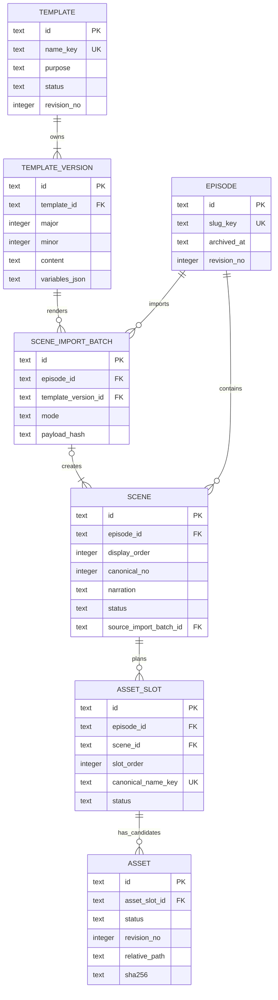

# M5 Contract — Domain & Persistence Foundation

- **Status:** M5A Approved ngày 2026-10-24; là baseline đã dùng để implement M5B.
- **Phạm vi:** domain model, validation, SQLite schema, migration strategy, repository boundary và typed IPC.
- **Implementation status:** M5B đã cài `node:sqlite`/Zod, migration runner, repository/application services và typed preload/IPC; UI chưa nối persistence đúng điểm dừng đã duyệt.
- **Nguồn UX:** M1–M4 và workflow `Episode → Scenes → Assets`.

## 1. Nguyên tắc thiết kế

1. `Script` không phải entity, table, repository, IPC namespace hoặc revision stream.
2. Narration/voice-over nằm trực tiếp trên `Scene`.
3. `Nội dung nguồn`, rendered prompt và raw JSON đang preview là dữ liệu tạm; không ghi database, backup hoặc log. Provenance import chỉ lưu liên kết/hashes tối thiểu trong `SceneImportBatch`.
4. `TemplateVersion` là snapshot bất biến. `Template`, `Episode`, `Scene`, `AssetSlot` và `Asset` là current-state entity có optimistic concurrency bằng `revision_no`.
5. `AssetSlot` mô tả đầu ra cần có; `Asset` mô tả candidate/file thực tế. Một slot có thể có nhiều Asset nhưng tối đa một Asset được accepted.
6. Binary media không nằm trong SQLite. Database chỉ giữ relative path và metadata; path tuyệt đối được resolve từ workspace root.
7. Renderer không biết SQL, filesystem hoặc transaction. Renderer chỉ gọi typed use case qua preload.
8. Business invariant được kiểm tra ở application service; invariant có thể biểu diễn an toàn bằng constraint/index thì tiếp tục được khóa ở SQLite.

## 2. Domain model

### 2.1. Enum chuẩn

| Type | Giá trị |
| --- | --- |
| `TemplatePurpose` | `scene`, `thumbnail`, `hook`, `description`, `idea`, `other` |
| `TemplateStatus` | `experimental`, `active`, `inactive` |
| `EpisodeTopic` | `animals`, `health`, `history`, `psychology`, `science` |
| `EpisodeWorkflowStatus` | `draft`, `scenes_ready`, `producing`, `ready_to_export`; projection, không persist |
| `SceneStatus` | `draft`, `in_review`, `approved`, `needs_changes` |
| `SceneType` | `MAIN_CHARACTER`, `ENVIRONMENT`, `SCIENTIFIC_VISUALIZATION`, `MOTION_GRAPHIC`, `B_ROLL` |
| `MediaType` | `image`, `video` |
| `AssetSlotStatus` | `draft`, `ready`, `fulfilled` |
| `AssetStatus` | `candidate`, `accepted`, `rejected` |
| `AssetOrigin` | `imported`, `generated` |
| `AssetFileIntegrity` | `unattached`, `available`, `missing`, `hash_mismatch`; projection, không persist |

Các enum legacy trong mock UI không đi vào schema:

- Episode `idea` → workflow projection `draft`.
- Episode `script-ready` → `scenes_ready`.
- Episode `in-progress` → `producing`.
- Episode `complete` chỉ đổi thành `ready_to_export` khi invariant hoàn tất được thỏa.
- Scene `in-progress` → `in_review`.
- Asset UI `Chờ tạo / Đang tạo / Đã tạo` là projection từ Slot/Asset; trạng thái queue/generation chỉ được bổ sung cùng job model ở Phase 2.

### 2.2. Entity và field

#### `Template`

| Field | Contract |
| --- | --- |
| `id` | UUID v4 do main process sinh |
| `name`, `nameKey` | Tên hiển thị và khóa đã trim + Unicode NFC + lowercase để unique |
| `description` | Mô tả tại browse/detail |
| `purpose` | `TemplatePurpose`; Scene Template dùng `scene` |
| `status` | `TemplateStatus` |
| `revisionNo` | Optimistic concurrency cho metadata |
| `createdByName` | Nhãn audit local; chưa có User/account entity |
| `createdAt`, `updatedAt` | UTC ISO-8601 |
| `currentVersion` | Giá trị dẫn xuất: version có `(major, minor)` lớn nhất, không lưu pointer riêng |
| `usageCount` | Giá trị dẫn xuất từ SceneImportBatch tham chiếu version, không lưu counter |

#### `TemplateVersion`

| Field | Contract |
| --- | --- |
| `id`, `templateId` | Identity và owner |
| `major`, `minor` | M2 chỉ tạo minor version; unique trong Template |
| `content` | Prompt source giữ nguyên whitespace |
| `variables` | Snapshot JSON đã validate của variable definitions |
| `changeNote` | Lý do tạo snapshot |
| `contentHash` | SHA-256 của content + canonicalized variables để kiểm tra snapshot |
| `createdByName`, `createdAt` | Audit tối thiểu cho local single-user |

Version không có `updatedAt`; repository không expose update/delete version.

#### `Episode`

| Field | Contract |
| --- | --- |
| `id` | UUID v4 |
| `title`, `slug`, `slugKey` | Tên hiển thị, folder-safe slug và khóa unique |
| `topic` | `EpisodeTopic` |
| `description`, `notes` | Nội dung metadata hiện hành |
| `thumbnailRelativePath` | Nullable, relative trong workspace; không lưu blob |
| `revisionNo` | Tăng khi metadata hoặc cấu trúc Scene của Episode đổi |
| `createdByName`, `updatedByName` | Nhãn audit local phục vụ list/detail; không phải foreign key User |
| `createdAt`, `updatedAt`, `archivedAt` | UTC; `archivedAt != null` là trạng thái archive duy nhất được persist |
| `workflowStatus` | Projection `draft/scenes_ready/producing/ready_to_export`, không phải column |

`sceneCount` và production progress là projection, không phải source-of-truth column.

#### `Scene`

| Field | Contract |
| --- | --- |
| `id`, `episodeId` | Identity và Episode owner |
| `displayOrder` | Thứ tự biên tập hiện hành, contiguous trong Episode |
| `canonicalNo` | Số ổn định dùng trong canonical asset name; không đổi khi reorder |
| `title`, `summary` | Tên bắt buộc và tóm tắt tùy chọn |
| `narration` | Narration/voice-over trực tiếp của Scene |
| `visualDescription` | Mô tả hình ảnh dùng khi review và làm đầu vào prompt |
| `sceneType`, `defaultMediaType` | Giá trị theo enum chuẩn |
| `notes` | Ghi chú nội bộ |
| `status`, `approvedAt` | Lifecycle review; GPT import luôn bắt đầu `draft` |
| `sourceImportBatchId` | Nullable với Scene tạo thủ công; trỏ tới provenance batch khi import |
| `revisionNo` | Optimistic concurrency cho edit/approval |
| `createdAt`, `updatedAt` | UTC |

Không có `SceneRevision` trong Phase 1. Sửa nội dung của Scene đã approved đưa Scene về `draft`, xóa `approvedAt` và tăng `revisionNo`.

#### `AssetSlot`

| Field | Contract |
| --- | --- |
| `id`, `episodeId`, `sceneId` | Identity; `episodeId` được lặp có kiểm soát để DB enforce canonical name unique trong Episode |
| `slotOrder` | Thứ tự slot trong Scene |
| `canonicalName`, `canonicalNameKey` | `scene-{canonicalNo:02}-{slotOrder:02}` và khóa normalized |
| `mediaType` | `image` hoặc `video` |
| `prompt` | Working prompt hiện hành của slot |
| `required` | Slot bắt buộc để Episode hoàn tất hay không |
| `status` | `AssetSlotStatus` |
| `revisionNo` | Optimistic concurrency |
| `createdAt`, `updatedAt` | UTC |

Khi import JSON không có `assetSlots`, application service tạo một slot bắt buộc, `slotOrder = 1`, dùng `defaultMediaType`; prompt ban đầu lấy từ `visualDescription`. Người dùng có thể thêm nhiều slot sau đó.

#### `Asset`

| Field | Contract |
| --- | --- |
| `id`, `assetSlotId` | Candidate/file thuộc một logical slot |
| `status` | Lifecycle `candidate`, `accepted`, `rejected`; file integrity không ghi đè field này |
| `origin` | `imported` hoặc `generated`; Phase 2 có thể bổ sung attempt reference bằng migration |
| `promptSnapshot` | Prompt thực sự dùng để tạo/import candidate; không đọc ngược từ working prompt |
| `relativePath`, `previewRelativePath` | Nullable cho candidate chưa có file; luôn relative trong workspace |
| `fileName`, `mimeType`, `bytes`, `sha256` | Metadata file |
| `width`, `height`, `durationMs` | Metadata media; duration chỉ dùng cho video |
| `revisionNo` | Optimistic concurrency cho accept/reject/archive |
| `createdAt`, `acceptedAt`, `rejectedAt`, `archivedAt` | Lifecycle timestamp |

`fileIntegrity` được derive khi đọc/preflight: không có path → `unattached`; path không tồn tại → `missing`; file tồn tại nhưng hash khác → `hash_mismatch`; hợp lệ → `available`. `Xóa` trong UI sẽ archive metadata bằng `archivedAt`; không tự động xóa file local. Một partial unique index bảo đảm mỗi slot chỉ có tối đa một Asset active ở status `accepted`.

#### `SceneImportBatch` — provenance tối thiểu

| Field | Contract |
| --- | --- |
| `id`, `episodeId`, `templateVersionId` | Correlation của một lần commit import với Episode và Scene Template version |
| `mode` | `append` hoặc `replace` |
| `payloadHash`, `renderedPromptHash?` | Hash để truy vết input đã preview và, nếu còn trong phiên, prompt đã render; không lưu raw JSON/prompt |
| `sceneCount`, `createdAt` | Số Scene được tạo và thời điểm import |

Đây là record provenance do `SceneCreationService` sở hữu, không phải module nghiệp vụ độc lập: không có màn hình CRUD, status, revision, repository hoặc IPC namespace riêng. Nhiều Scene của cùng lần import trỏ tới một batch; từ batch truy được đúng `TemplateVersion`.

## 3. Entity/relationship



Quan hệ không tồn tại: Episode → Script, Script → Scene, Script revision hoặc narration document cấp Episode.

## 4. Validation contract

### 4.1. Quy tắc chung

- ID nhận qua IPC phải là UUID hợp lệ; ID mới chỉ do main process sinh.
- String được trim để kiểm tra nhưng field cần giữ whitespace như template `content`, narration và prompt không bị tự ý format lại.
- Timestamp lưu UTC dạng `YYYY-MM-DDTHH:mm:ss.SSSZ`; renderer format theo locale.
- Normalized key dùng Unicode NFC và lowercase nhất quán trong application layer trước khi ghi DB.
- Mỗi request IPC tối đa 1 MiB; JSON Scenes tối đa 200 Scene; mọi array có giới hạn rõ.
- Unknown key trong command bị reject. Response cũng được validate trước khi trả qua preload.
- Mọi mutation current-state nhận `expectedRevisionNo`; mismatch trả `STALE_REVISION`, không last-write-wins. `SceneImportBatch` và `TemplateVersion` là record bất biến nên không có revision.

### 4.2. Field rules

| Entity | Quy tắc chặn |
| --- | --- |
| Template | name 3–80, description 10–240, `nameKey` unique |
| TemplateVersion | content 1–20.000, change note 3–160, variable name theo `^[a-z][a-z0-9_]*$`, placeholder/definition hợp lệ theo M2 contract |
| Episode | title 3–100, description 10–240, notes ≤240, slug 3–100 và folder-safe |
| Scene | title 1–120, summary ≤500, narration ≤10.000, visual description ≤5.000, notes ≤2.000 |
| AssetSlot | slot order 1–999, prompt ≤20.000, canonical name ASCII lowercase theo `^scene-[0-9]{2,}-[0-9]{2,}$` |
| Asset | relative path không absolute/không traversal; bytes ≥0; width/height >0 nếu có; duration video >0 nếu có |

### 4.3. Status invariant

- Episode archived khi `archivedAt != null`; nếu chưa archive thì `workflowStatus` được derive theo thứ tự ưu tiên: `ready_to_export` nếu đủ điều kiện export; `producing` nếu đã có Asset active nhưng chưa đủ export; `scenes_ready` nếu có ít nhất một Scene và mọi Scene approved; còn lại là `draft`.
- Episode `ready_to_export`: mọi Scene approved, mọi slot bắt buộc `fulfilled`, Asset accepted có `fileIntegrity = available`.
- Scene chỉ chuyển `approved` khi title, narration, visual description, scene type và default media type hợp lệ.
- Sửa field nội dung của Scene approved tự động demote về `draft`; sửa notes đơn thuần không demote.
- AssetSlot `draft` khi Scene/prompt chưa sẵn sàng; `ready` khi Scene approved, prompt hợp lệ và chưa có Asset accepted; `fulfilled` khi có đúng một active Asset `accepted`.
- Accept Asset là transaction: reject Asset accepted cũ nếu có, accept candidate mới và cập nhật slot.
- File mất hoặc hash mismatch chỉ đổi projection `fileIntegrity`, không tự đổi lifecycle `accepted` thành trạng thái khác; export/preflight vẫn bị chặn.
- Episode/Template archive hoặc inactive không cascade xóa child/file.

### 4.4. JSON Scenes import v1

Envelope bắt buộc:

```json
{
  "schemaVersion": 1,
  "scenes": [
    {
      "order": 1,
      "title": "Hook",
      "summary": "Mở vấn đề",
      "narration": "Có bao giờ bạn tự hỏi...",
      "visualDescription": "Cậu bé ngồi trước hiên nhà lúc hoàng hôn.",
      "sceneType": "MAIN_CHARACTER",
      "mediaType": "video",
      "notes": "Giữ nhịp chậm",
      "assetSlots": [
        {
          "order": 1,
          "mediaType": "video",
          "prompt": "Cinematic warm sunset, 16:9",
          "required": true
        }
      ]
    }
  ]
}
```

Quy tắc:

- `schemaVersion`, `order`, `title`, `narration`, `visualDescription`, `sceneType`, `mediaType` bắt buộc.
- `summary`, `notes`, `assetSlots` tùy chọn; unknown field bị reject để phát hiện schema drift.
- Scene order unique và đúng tập `1..N`; slot order unique và đúng `1..M` trong từng Scene.
- JSON không nhận database ID, status, canonical name, timestamp hoặc approved flag.
- App có thể bóc đúng một outer Markdown fence ` ```json ... ``` ` trước khi parse; JSON bên trong vẫn strict và unknown field vẫn bị reject.
- `templateVersionId` lấy từ selection tin cậy của app, không lấy từ JSON. `renderedPromptHash` chỉ set khi import còn gắn được với kết quả render trong phiên; provenance vẫn hợp lệ qua batch + TemplateVersion khi hash này vắng mặt.
- Validate toàn payload trước khi mở transaction. `payloadHash` là SHA-256 của chuỗi UTF-8 `rawJson` chính xác; commit revalidate hash để payload preview và payload ghi là cùng một nội dung. Hash là consistency guard, không phải security signature.
- `append` tạo một `SceneImportBatch`, cấp `displayOrder` tiếp theo và `canonicalNo = max hiện tại + 1...N`.
- `replace` chỉ được phép khi graph hiện tại chưa từng có bất kỳ Asset row nào; nếu không trả `SCENES_REPLACE_CONFLICT`. Replace xóa tường minh Slot → Scene → import batch cũ rồi tạo batch/graph mới, reset `displayOrder` và `canonicalNo` về `1..N`.
- Phase 1 không expose xóa riêng Scene. Vì vậy canonical number ổn định sau import/reorder; quy tắc không tái sử dụng chỉ bắt đầu khi graph đã có Asset và lúc đó replace bị khóa.
- Import thành công tạo `SceneImportBatch` + toàn bộ Scene + AssetSlot trong một transaction; bất kỳ lỗi nào rollback toàn bộ.

## 5. SQLite schema đề xuất

Tên file migration dự kiến: `0001_phase1_core.sql`. Đây là DDL review, chưa được tạo thành migration executable trong lượt này.

```sql
PRAGMA foreign_keys = ON;

CREATE TABLE schema_migrations (
  version INTEGER PRIMARY KEY,
  name TEXT NOT NULL,
  checksum TEXT NOT NULL,
  applied_at TEXT NOT NULL,
  app_version TEXT NOT NULL
) STRICT;

CREATE TABLE prompt_templates (
  id TEXT PRIMARY KEY,
  name TEXT NOT NULL,
  name_key TEXT NOT NULL UNIQUE,
  description TEXT NOT NULL,
  purpose TEXT NOT NULL CHECK (purpose IN ('scene','thumbnail','hook','description','idea','other')),
  status TEXT NOT NULL CHECK (status IN ('experimental','active','inactive')),
  revision_no INTEGER NOT NULL DEFAULT 1 CHECK (revision_no >= 1),
  created_by_name TEXT NOT NULL,
  created_at TEXT NOT NULL,
  updated_at TEXT NOT NULL,
  CHECK (length(trim(name)) BETWEEN 3 AND 80),
  CHECK (length(trim(description)) BETWEEN 10 AND 240)
) STRICT;

CREATE TABLE prompt_template_versions (
  id TEXT PRIMARY KEY,
  template_id TEXT NOT NULL REFERENCES prompt_templates(id) ON DELETE RESTRICT,
  major INTEGER NOT NULL DEFAULT 1 CHECK (major >= 1),
  minor INTEGER NOT NULL CHECK (minor >= 0),
  content TEXT NOT NULL CHECK (length(content) BETWEEN 1 AND 20000),
  variables_json TEXT NOT NULL CHECK (json_valid(variables_json)),
  change_note TEXT NOT NULL CHECK (length(trim(change_note)) BETWEEN 3 AND 160),
  content_hash TEXT NOT NULL CHECK (length(content_hash) = 64),
  created_by_name TEXT NOT NULL,
  created_at TEXT NOT NULL,
  UNIQUE (template_id, major, minor)
) STRICT;

CREATE INDEX ix_template_versions_current
  ON prompt_template_versions(template_id, major DESC, minor DESC);

CREATE TABLE episodes (
  id TEXT PRIMARY KEY,
  title TEXT NOT NULL,
  slug TEXT NOT NULL,
  slug_key TEXT NOT NULL UNIQUE,
  topic TEXT NOT NULL CHECK (topic IN ('animals','health','history','psychology','science')),
  description TEXT NOT NULL,
  notes TEXT NOT NULL DEFAULT '',
  thumbnail_relative_path TEXT,
  revision_no INTEGER NOT NULL DEFAULT 1 CHECK (revision_no >= 1),
  created_by_name TEXT NOT NULL,
  updated_by_name TEXT NOT NULL,
  created_at TEXT NOT NULL,
  updated_at TEXT NOT NULL,
  archived_at TEXT,
  CHECK (length(trim(title)) BETWEEN 3 AND 100),
  CHECK (length(trim(description)) BETWEEN 10 AND 240),
  CHECK (length(notes) <= 240)
) STRICT;

CREATE TABLE scene_import_batches (
  id TEXT PRIMARY KEY,
  episode_id TEXT NOT NULL REFERENCES episodes(id) ON DELETE RESTRICT,
  template_version_id TEXT NOT NULL REFERENCES prompt_template_versions(id) ON DELETE RESTRICT,
  mode TEXT NOT NULL CHECK (mode IN ('append','replace')),
  payload_hash TEXT NOT NULL CHECK (length(payload_hash) = 64),
  rendered_prompt_hash TEXT CHECK (rendered_prompt_hash IS NULL OR length(rendered_prompt_hash) = 64),
  scene_count INTEGER NOT NULL CHECK (scene_count BETWEEN 1 AND 200),
  created_at TEXT NOT NULL,
  UNIQUE (id, episode_id)
) STRICT;

CREATE INDEX ix_scene_import_batches_episode
  ON scene_import_batches(episode_id, created_at);

CREATE TABLE scenes (
  id TEXT PRIMARY KEY,
  episode_id TEXT NOT NULL REFERENCES episodes(id) ON DELETE RESTRICT,
  display_order INTEGER NOT NULL CHECK (display_order >= 1),
  canonical_no INTEGER NOT NULL CHECK (canonical_no >= 1),
  title TEXT NOT NULL,
  summary TEXT NOT NULL DEFAULT '',
  narration TEXT NOT NULL DEFAULT '',
  visual_description TEXT NOT NULL DEFAULT '',
  scene_type TEXT NOT NULL CHECK (scene_type IN ('MAIN_CHARACTER','ENVIRONMENT','SCIENTIFIC_VISUALIZATION','MOTION_GRAPHIC','B_ROLL')),
  default_media_type TEXT NOT NULL CHECK (default_media_type IN ('image','video')),
  notes TEXT NOT NULL DEFAULT '',
  status TEXT NOT NULL DEFAULT 'draft' CHECK (status IN ('draft','in_review','approved','needs_changes')),
  source_import_batch_id TEXT,
  revision_no INTEGER NOT NULL DEFAULT 1 CHECK (revision_no >= 1),
  approved_at TEXT,
  created_at TEXT NOT NULL,
  updated_at TEXT NOT NULL,
  FOREIGN KEY (source_import_batch_id, episode_id) REFERENCES scene_import_batches(id, episode_id) ON DELETE RESTRICT,
  UNIQUE (id, episode_id),
  UNIQUE (episode_id, display_order),
  UNIQUE (episode_id, canonical_no),
  CHECK (length(trim(title)) BETWEEN 1 AND 120),
  CHECK (length(summary) <= 500),
  CHECK (length(narration) <= 10000),
  CHECK (length(visual_description) <= 5000),
  CHECK (length(notes) <= 2000),
  CHECK (status <> 'approved' OR (length(trim(narration)) > 0 AND length(trim(visual_description)) > 0 AND approved_at IS NOT NULL)),
  CHECK (status = 'approved' OR approved_at IS NULL)
) STRICT;

CREATE TABLE asset_slots (
  id TEXT PRIMARY KEY,
  episode_id TEXT NOT NULL,
  scene_id TEXT NOT NULL,
  slot_order INTEGER NOT NULL CHECK (slot_order BETWEEN 1 AND 999),
  canonical_name TEXT NOT NULL,
  canonical_name_key TEXT NOT NULL,
  media_type TEXT NOT NULL CHECK (media_type IN ('image','video')),
  prompt TEXT NOT NULL DEFAULT '' CHECK (length(prompt) <= 20000),
  required INTEGER NOT NULL DEFAULT 1 CHECK (required IN (0,1)),
  status TEXT NOT NULL DEFAULT 'draft' CHECK (status IN ('draft','ready','fulfilled')),
  revision_no INTEGER NOT NULL DEFAULT 1 CHECK (revision_no >= 1),
  created_at TEXT NOT NULL,
  updated_at TEXT NOT NULL,
  FOREIGN KEY (scene_id, episode_id) REFERENCES scenes(id, episode_id) ON DELETE RESTRICT,
  UNIQUE (scene_id, slot_order),
  UNIQUE (episode_id, canonical_name_key)
) STRICT;

CREATE INDEX ix_asset_slots_episode ON asset_slots(episode_id, scene_id, slot_order);

CREATE TABLE assets (
  id TEXT PRIMARY KEY,
  asset_slot_id TEXT NOT NULL REFERENCES asset_slots(id) ON DELETE RESTRICT,
  status TEXT NOT NULL CHECK (status IN ('candidate','accepted','rejected')),
  origin TEXT NOT NULL CHECK (origin IN ('imported','generated')),
  prompt_snapshot TEXT NOT NULL DEFAULT '' CHECK (length(prompt_snapshot) <= 20000),
  relative_path TEXT,
  preview_relative_path TEXT,
  file_name TEXT,
  mime_type TEXT,
  bytes INTEGER CHECK (bytes IS NULL OR bytes >= 0),
  sha256 TEXT CHECK (sha256 IS NULL OR length(sha256) = 64),
  width INTEGER CHECK (width IS NULL OR width > 0),
  height INTEGER CHECK (height IS NULL OR height > 0),
  duration_ms INTEGER CHECK (duration_ms IS NULL OR duration_ms > 0),
  revision_no INTEGER NOT NULL DEFAULT 1 CHECK (revision_no >= 1),
  created_at TEXT NOT NULL,
  accepted_at TEXT,
  rejected_at TEXT,
  archived_at TEXT,
  CHECK (status <> 'accepted' OR accepted_at IS NOT NULL),
  CHECK (status <> 'rejected' OR rejected_at IS NOT NULL)
) STRICT;

CREATE UNIQUE INDEX ux_assets_one_accepted_per_slot
  ON assets(asset_slot_id)
  WHERE status = 'accepted' AND archived_at IS NULL;

CREATE UNIQUE INDEX ux_assets_active_relative_path
  ON assets(relative_path)
  WHERE relative_path IS NOT NULL AND archived_at IS NULL;
```

Các invariant cross-table như “slot ready cần Scene approved” và “slot fulfilled cần Asset accepted” bắt buộc nằm trong application service transaction; không dùng trigger ẩn. File integrity được kiểm tra từ filesystem/hash khi query hoặc preflight, không có column lifecycle thứ hai trong `assets`.

## 6. Migration strategy

1. Migration SQL tuần tự, forward-only: `0001_phase1_core.sql`, `0002_...sql`; file đã apply không được sửa.
2. `schema_migrations` lưu version, tên, checksum, app version và thời điểm. Checksum mismatch là lỗi startup có hướng dẫn phục hồi, không âm thầm chạy tiếp.
3. Main process là migration owner duy nhất. Renderer không mở database.
4. Mỗi migration chạy bằng `BEGIN IMMEDIATE` và rollback toàn bộ nếu lỗi. Không thực hiện network/filesystem side effect trong cùng SQL transaction.
5. Database mới chạy toàn bộ migration, không cần backup. Database đã có dữ liệu phải checkpoint WAL và tạo backup nhất quán trước migration có thay đổi schema/data.
6. Backup dùng tên có timestamp + schema version; chỉ xóa bằng thao tác người dùng hoặc retention được duyệt sau.
7. Không viết down migration tổng quát. Phục hồi bằng backup + forward fix migration.
8. Startup cấu hình `foreign_keys=ON`, `journal_mode=WAL`, `busy_timeout=5000`; migration hoàn tất trước khi register business IPC.
9. Test bắt buộc khi implement: empty DB → latest, N-1 fixture → latest, migration lỗi → rollback, checksum mismatch, FK violation và packaged Windows native-module smoke test.
10. Mock seed không chạy trong production DB. Test fixture là file riêng và versioned theo schema.

## 7. Repository boundary

Repository thuộc main/infrastructure, nhận/trả domain object; không trả row SQLite và không chứa UI text.

```ts
interface TemplateRepository {
  list(query: TemplateListQuery): Page<TemplateSummary>
  getById(id: TemplateId): TemplateAggregate | null
  insert(template: Template, initialVersion: TemplateVersion): void
  updateMetadata(input: UpdateTemplateRecord): Template
  appendVersion(input: AppendTemplateVersionRecord): TemplateVersion
}

interface EpisodeRepository {
  list(query: EpisodeListQuery): Page<EpisodeSummary>
  getById(id: EpisodeId): EpisodeAggregate | null
  insert(episode: Episode): void
  update(input: UpdateEpisodeRecord): Episode
  archive(id: EpisodeId, expectedRevisionNo: number, at: UtcTimestamp): Episode
}

interface SceneRepository {
  listByEpisode(episodeId: EpisodeId): Scene[]
  getById(id: SceneId): Scene | null
  getImportBatchById(id: SceneImportBatchId): SceneImportBatch | null
  insertImportBatch(batch: SceneImportBatch): void
  insertMany(scenes: Scene[]): void
  update(input: UpdateSceneRecord): Scene
  replaceDisplayOrder(episodeId: EpisodeId, orderedIds: SceneId[]): void
  deleteDraftGraphByEpisode(episodeId: EpisodeId): void
  deleteOrphanImportBatchesByEpisode(episodeId: EpisodeId): void
}

interface AssetSlotRepository {
  listByEpisode(episodeId: EpisodeId): AssetSlot[]
  getById(id: AssetSlotId): AssetSlot | null
  insertMany(slots: AssetSlot[]): void
  update(input: UpdateAssetSlotRecord): AssetSlot
}

interface AssetRepository {
  listByEpisode(episodeId: EpisodeId, query: AssetListQuery): Page<AssetProjection>
  getById(id: AssetId): AssetProjection | null
  insert(asset: Asset): void
  transition(input: TransitionAssetRecord): Asset
  archive(id: AssetId, expectedRevisionNo: number, at: UtcTimestamp): void
}
```

Quy tắc boundary:

- Repository chỉ thực hiện persistence primitives và optimistic update `WHERE revision_no = expectedRevisionNo`.
- Application service sở hữu validation, status transition, canonical naming và transaction nhiều repository.
- `UnitOfWork.transaction(fn)` là synchronous callback trong main; không `await` bên trong transaction với driver `node:sqlite` đã chọn ở D-031.
- Không có `ScriptRepository`, generic `executeSql`, generic key/value repository hoặc repository gọi renderer.
- Query list trả projection/pagination; aggregate detail chỉ load khi mở editor/detail.

Transaction bắt buộc:

- Tạo Template + initial version.
- Append version + update Template metadata/revision nếu cùng command.
- Import/replace JSON Scenes + provenance batch + initial AssetSlots + bump Episode revision.
- Reorder Scenes + bump Episode revision.
- Accept Asset + reject accepted Asset cũ + update AssetSlot; mọi Asset mutation kiểm tra revision.
- Archive Episode metadata; không cascade xóa file.

## 8. Typed IPC contract

Shared request/response schema đặt trong module không phụ thuộc Electron/React/SQLite. Preload expose API theo use case, không expose `ipcRenderer` hoặc channel tự do.

```ts
type DomainErrorCode =
  | "VALIDATION_ERROR"
  | "NOT_FOUND"
  | "DUPLICATE_NAME"
  | "STALE_REVISION"
  | "INVALID_TRANSITION"
  | "IMPORT_INVALID"
  | "SCENES_REPLACE_CONFLICT"
  | "FILE_OUTSIDE_WORKSPACE"
  | "DB_UNAVAILABLE"
  | "MIGRATION_REQUIRED"
  | "INTERNAL_ERROR"

type IpcResult<T> =
  | { ok: true; data: T }
  | { ok: false; error: { code: DomainErrorCode; message: string; fieldErrors?: Record<string, string>; retryable: boolean } }

interface StudioApi {
  templates: {
    list(input: TemplateListQuery): Promise<IpcResult<Page<TemplateSummary>>>
    get(input: { id: TemplateId }): Promise<IpcResult<TemplateAggregate>>
    create(input: CreateTemplateCommand): Promise<IpcResult<TemplateAggregate>>
    updateMetadata(input: UpdateTemplateCommand): Promise<IpcResult<Template>>
    createVersion(input: CreateTemplateVersionCommand): Promise<IpcResult<TemplateVersion>>
    render(input: RenderTemplateCommand): Promise<IpcResult<RenderedPrompt>>
  }
  episodes: {
    list(input: EpisodeListQuery): Promise<IpcResult<Page<EpisodeSummary>>>
    get(input: { id: EpisodeId }): Promise<IpcResult<EpisodeAggregate>>
    create(input: CreateEpisodeCommand): Promise<IpcResult<Episode>>
    update(input: UpdateEpisodeCommand): Promise<IpcResult<Episode>>
    archive(input: ArchiveEpisodeCommand): Promise<IpcResult<Episode>>
  }
  sceneCreation: {
    renderPrompt(input: RenderScenePromptCommand): Promise<IpcResult<RenderedPrompt>>
    validateImport(input: ValidateScenesImportCommand): Promise<IpcResult<ScenesImportPreview>>
    commitImport(input: CommitScenesImportCommand): Promise<IpcResult<ScenesImportResult>>
  }
  scenes: {
    list(input: { episodeId: EpisodeId }): Promise<IpcResult<Scene[]>>
    get(input: { id: SceneId }): Promise<IpcResult<SceneDetail>>
    update(input: UpdateSceneCommand): Promise<IpcResult<Scene>>
    reorder(input: ReorderScenesCommand): Promise<IpcResult<Scene[]>>
    transitionStatus(input: TransitionSceneStatusCommand): Promise<IpcResult<Scene>>
  }
  assetSlots: {
    list(input: { episodeId: EpisodeId }): Promise<IpcResult<AssetSlot[]>>
    create(input: CreateAssetSlotCommand): Promise<IpcResult<AssetSlot>>
    update(input: UpdateAssetSlotCommand): Promise<IpcResult<AssetSlot>>
  }
  assets: {
    list(input: AssetListQuery): Promise<IpcResult<Page<AssetProjection>>>
    get(input: { id: AssetId }): Promise<IpcResult<AssetProjection>>
    registerImported(input: RegisterImportedAssetCommand): Promise<IpcResult<AssetProjection>>
    accept(input: AcceptAssetCommand): Promise<IpcResult<AssetProjection>>
    reject(input: RejectAssetCommand): Promise<IpcResult<AssetProjection>>
    archive(input: ArchiveAssetCommand): Promise<IpcResult<{ id: AssetId }>>
  }
}
```

Command quan trọng:

- `RenderScenePromptCommand`: `episodeId`, `templateVersionId`, transient `sourceContent?`, preview values. `sourceContent` không được log/persist.
- `ValidateScenesImportCommand`: `episodeId`, `templateVersionId`, `renderedPromptHash?`, `mode`, `rawJson`; trả normalized preview, warning/conflict và `payloadHash`.
- `CommitScenesImportCommand`: gửi lại `rawJson`, hai hash, template version, mode và `expectedEpisodeRevisionNo`; main revalidate rồi mới mở transaction, tạo `SceneImportBatch` và trả `importBatchId`.
- `Update*Command`: chỉ nhận allowlisted patch và `expectedRevisionNo`; không nhận raw row.
- `ReorderScenesCommand`: toàn bộ ordered Scene IDs + `expectedEpisodeRevisionNo`; không đổi `canonicalNo`.
- `RegisterImportedAssetCommand`: main kiểm tra file qua dialog/path boundary; renderer không tự gửi arbitrary path để database tin tưởng.
- `AcceptAssetCommand`, `RejectAssetCommand` và `ArchiveAssetCommand` nhận `expectedRevisionNo`; response Asset projection luôn tách `status` khỏi `fileIntegrity`.

## 9. Application services và ownership

| Service | Trách nhiệm |
| --- | --- |
| `TemplateService` | metadata, immutable version, variable validation, render |
| `EpisodeService` | CRUD/archive và workflow status projection |
| `SceneCreationService` | render transient prompt, validate/preview/commit JSON import |
| `SceneService` | edit, reorder, approval, revision conflict |
| `AssetPlanningService` | slot CRUD, canonical number/name, readiness |
| `AssetService` | candidate metadata, accept/reject/archive, file-boundary validation |

Service không gọi lẫn nhau vòng tròn. Shared domain policy như `canApproveScene`, `canonicalAssetName` và status transition là pure function.

## 10. Approved baseline cho M5B

Các quyết định sau đã được duyệt ngày 2026-10-24:

1. Episode chỉ persist `archivedAt`; workflow status là projection.
2. AssetSlot dùng `draft/ready/fulfilled`; queue/generation state chờ job model Phase 2.
3. `displayOrder` tách khỏi `canonicalNo`; reorder không rename. Replace asset-free được reset canonical, Phase 1 không xóa riêng Scene.
4. Hard delete dùng FK `RESTRICT`; replace xóa graph tường minh trong transaction. Archive không xóa binary.
5. Mọi current-state entity, gồm `Asset`, dùng optimistic concurrency.
6. JSON v1 strict, chấp nhận bóc outer Markdown fence, preview/commit dùng payload hash và luôn tạo Scene ở `draft`.
7. `AssetSlot` và `Asset` là hai entity; import thiếu slots tự tạo một required slot.
8. Asset lifecycle chỉ có `candidate/accepted/rejected`; file integrity là projection độc lập.
9. Scene import có provenance tối thiểu qua `SceneImportBatch` → `TemplateVersion`; không persist raw prompt, raw JSON hoặc `Nội dung nguồn`.
10. Template variables là immutable JSON snapshot; migration forward-only có checksum/backup; typed IPC theo use case; `CharacterReference` deferred khỏi `0001`.

M5A đã Approved. M5B đã implement theo baseline này và đang dừng tại checkpoint review trước M6.
